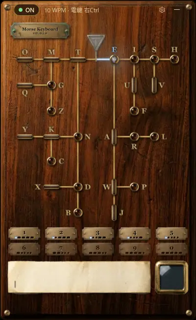
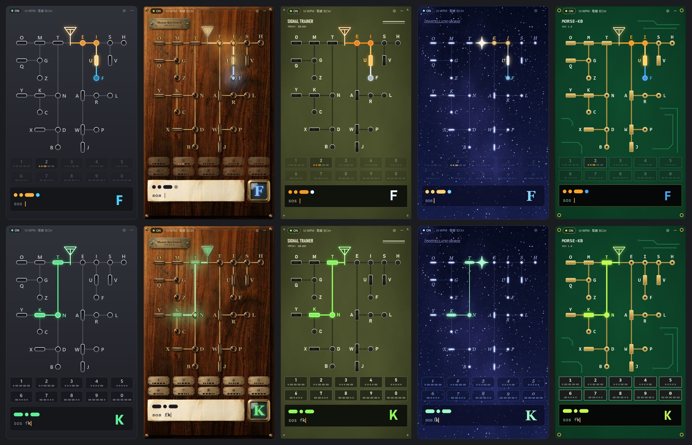
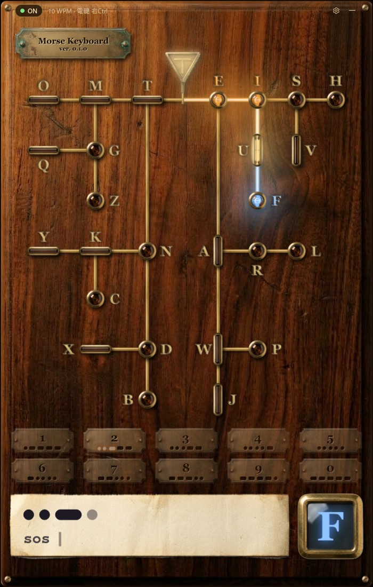

# Morse Keyboard

**1つのキーでモールス符号を打って覚える、Windows 用の学習支援アプリ。**
*A Windows overlay that turns one key into a Morse straight key and lights up the Morse tree as you type.*



電鍵にしたキー（初期値は右Ctrl）を長短で押すと、最前面に置いたモールスツリー上で「いまどこにいるか」が光り、確定した文字が前面のアプリにそのまま入力されます。
符号表を暗記する代わりに、**打ちながら木の形で覚える**ことを狙っています。

## 特徴

- **ツリーが光る**: 押している間は「離したら進む先」が水色で先に光り、長点の長さを超えると長点側に切り替わります。確定は緑、該当なしは赤
- **どのアプリにも入力できる**: グローバルフックで電鍵キーを受け取り、確定した文字を前面のアプリへ送ります。IME を通して送るモードもあり、日本語入力 ON ならローマ字で日本語を打てます
- **A–Z と 0–9**: 数字は 5 符号あるのでツリーの下に専用パネルを置き、入力中の符号と一致する部分が光ります
- **5 種類のデザイン**: クラシック / 電信局 / 軍用無線機 / 星座 / 回路基板
- **細かく調整できる**: 速度（WPM）、長点の長さ、文字・単語の区切り、サイドトーン、電鍵にするキー

## ダウンロード

[Releases](../../releases) から zip をダウンロードして展開し、`MorseKeyboard.exe` を実行します。

- Windows 10 / 11（x64）。.NET のインストールは不要です
- 署名のない exe なので、初回に Windows の警告が出ることがあります（「詳細情報」→「実行」）
- **キー入力を記録・送信しません。** 電鍵に指定したキーと `Ctrl+Alt+M` 以外のキーには触れず、ネットワーク通信も行いません。ファイルに書くのは設定（`%APPDATA%\MorseKeyboard\settings.json`）と、エラー時のログだけです

## デザイン



設定画面の「デザイン」で切り替えられます。上段は押している最中、下段は文字が確定した瞬間です。

「電信局」は画像生成 AI で作った写真を素材にしています。真鍮の縁のガラス電球が灯り、周りの木目を照らす表現で、数字の札・紙テープ・文字の彫り込みまで、実機の計器のような見た目にしました。



## 使い方

| 操作 | 動作 |
| --- | --- |
| 電鍵キーを短く押す | 短点（・） |
| 電鍵キーを長く押す | 長点（－）。標準では短点 2 個分以上押すと長点 |
| 離して短点 3 個分待つ | 文字が確定して前面のアプリに入力される |
| 離して短点 7 個分待つ | 空白が入力される（「キー入力として送る」モードでは入力しない） |
| Ctrl + Alt + M | モールス入力の ON / OFF。OFF の間、電鍵キーはふだんどおり動く |

電鍵キーは設定で右Ctrl・右Alt・無変換・変換・スペースから選べます。スペースを選んだ場合も、Shift / Ctrl / Alt と一緒に押せばふだんのスペースになります。

速度は WPM（1 分あたりの語数）で決まり、初期値は 10 WPM（短点 120 ms）です。空白が早く入りすぎる場合は、設定で「文字を確定するまでの間」と「単語を区切るまでの間」を長くしてください。

### ツリーの色

- **オレンジ**: ここまでに入力した経路
- **水色**: いま離すと進む先
- **緑**: 確定して入力された文字
- **赤**: 該当する文字がない（離すと何も入力されない）

### ウィンドウ

- ドラッグで移動、右下の角でサイズ変更
- ⚙ で設定、― で隠す（タスクトレイのアイコンをクリックすると再表示）
- タスクトレイのアイコンは ON のときオレンジ、OFF のとき灰色。右クリックで終了

## 設定

設定ウィンドウでの変更はすぐに反映されます。

- **タイミング**: 速度、長点とみなす長さ、文字確定・単語区切りまでの間、空白の自動入力
- **入力**
  - 電鍵にするキー: 右Ctrl（初期値）・右Alt・無変換・変換・スペース
  - 前面のアプリに入力する: オフにすると練習専用（ウィンドウ内で表示するだけ）
  - 大文字で入力する
  - キー入力として送る: IME を通して送ります。スペースは IME の変換キーになってしまうため、このモードでは単語区切りの空白を自動入力しません。空白・変換はスペースキー、確定は Enter でふだんどおり行えます
- **サイドトーン**: 押している間に鳴る音の ON / OFF、周波数、音量
- **表示・起動**: デザイン、ウィンドウの不透明度、起動時に ON にするか

## 技術的な見どころ

C# / .NET 10 / WPF。外部ライブラリは音声出力の NAudio だけです。

- **打鍵のタイミングを守る設計**: グローバルキーボードフックは専用スレッドで動かし、押下・解放の時刻を `Stopwatch` で取ります。サイドトーンはフックのスレッドで即座に鳴らし、判定と描画だけを UI スレッドに渡すので、画面が重くても打鍵の長さが狂いません（`KeyboardHook.cs`、`MorseDecoder.cs`）
- **他のアプリへの入力**: `SendInput` で Unicode 文字として送る方式と、キーストロークとして送る方式（IME を通す）を切り替えられます。自分が送った入力はフックで無視し、無限ループを防いでいます（`TextSender.cs`）
- **フォーカスを奪わない最前面ウィンドウ**: `WS_EX_NOACTIVATE` を指定し、入力中のアプリからフォーカスを奪いません。このとき OS 標準のドラッグ移動が効かないので、移動は自前で実装しています（`TreeWindow.xaml.cs`）
- **差し替えられるデザインの仕組み**: 色・形・質感・文字を `Theme` にまとめ、起動中に切り替えられます。木目・塗装・星空・基板の背景は、ノイズからコードで生成するので、画像素材なしで成り立ちます（`Theme.cs`、`Textures.cs`）
- **彫り込み文字**: 文字の輪郭を図形演算（`Geometry.Combine`）でずらして、左上の内壁の影・右下の内壁の光・外縁のハイライトを作り、光源に合わせた彫り込みに見せています。点灯すると溝の色が変わります（`EngravedText.cs`）
- **画像生成 AI の写真を素材にする取り込みツール**（`tools/AssetKit`）: 生成した写真から、背景の切り抜き（影やグラデーションに対応）、点灯版と消灯版の位置合わせ、差分からの光の取り出し、継ぎ目のない棒のタイル化、影の生成までを自動で行います。光はグレースケールで持ち、状態の色を実行時に付けるので、1 枚の光の画像が 5 つの状態に使えます
- **素材は部品ごとに差し替え可能**: 画像がない部品は、コードで描いた絵に自動で戻ります。`--assets <フォルダ>` を付けて起動すると、画像を保存するたびに表示へ反映されます（仕様は [design/ASSETS.md](design/ASSETS.md)）

## 開発について

- コードの実装は、AI コーディングツールの **Claude Code**（Anthropic）と対話しながら進めました。要件・設計方針・デザインの方向づけと選択・動作確認は作者が担当しています
- 「電信局」の部品画像は **Gemini** で生成した写真です。プロンプトは [design/prompts/telegraph.md](design/prompts/telegraph.md)、元画像は `design/raw/` にあります
- フォントは Windows 標準のもの（Georgia、Bahnschrift、Consolas など）だけを使っています

## ビルド

.NET 10 SDK が必要です。

```powershell
dotnet build -c Release
```

ビルド結果は、`Directory.Build.props` の設定でソースの外に出力されます。

```
%LOCALAPPDATA%\MorseKeyboard\artifacts\bin\MorseKeyboard\release\MorseKeyboard.exe
```

配布用の単体 exe を作る場合:

```powershell
dotnet publish -c Release -r win-x64 --self-contained true -p:PublishSingleFile=true -p:IncludeNativeLibrariesForSelfExtract=true -p:EnableCompressionInSingleFile=true -p:DebugType=none -o publish
```

## 制限

- 管理者権限で動いているアプリ（タスクマネージャーなど）には入力できません（Windows の仕様）
- 一部のゲームのように、キーボードを直接読むアプリでは動かないことがあります
- 自動テストは未整備です
- 問題が起きた場合は `%APPDATA%\MorseKeyboard\error.log` に記録されます

## ファイル構成

| ファイル | 役割 |
| --- | --- |
| `KeyboardHook.cs` | 全体キーボードフック。電鍵キーの横取りと ON / OFF のホットキー |
| `MorseDecoder.cs` | 押下・解放の時刻から短点・長点・文字・単語区切りを判定 |
| `KeyerKey.cs` | 電鍵にできるキーの一覧 |
| `MorseTable.cs` | A–Z と 0–9 の符号表 |
| `TextSender.cs` | 確定した文字を前面のアプリへ送信（SendInput） |
| `ToneGenerator.cs` | サイドトーン（NAudio） |
| `TreeWindow.xaml` / `MorseTreeCanvas.cs` / `DigitPanel.cs` | 最前面のツリー表示 |
| `EngravedText.cs` | 彫り込み風の文字 |
| `SettingsWindow.xaml` / `AppSettings.cs` | 設定画面と保存 |
| `TrayIcon.cs` | タスクトレイのアイコン |
| `Theme.cs` / `Themes.cs` / `Textures.cs` | デザインの定義と、木目などの背景をコードで生成する処理 |
| `ThemeAssets.cs` / `Assets/Themes/` | 部品ごとの PNG 素材の読み込みと素材本体 |
| `tools/AssetKit/` | 素材の叩き台の生成と、画像生成 AI の写真の取り込みツール |
| `design/` | 素材の仕様、画像生成のプロンプト、生成した元画像 |

## ライセンス

現時点では設定していません（実績の展示を目的とした公開です）。
